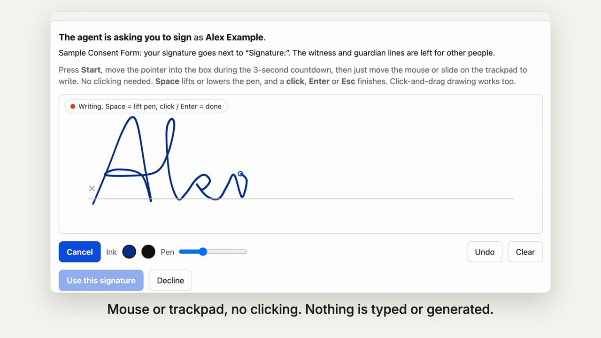

# SignPad

**Agent-assisted handwritten signing for `.docx` and `.pdf` documents, running on your own computer.**

Someone sends you a form and says "please sign and return it". SignPad's agent reads the document (and the request, if you give it), works out where your signature belongs, opens a signing pad in your browser where you draw your signature with the trackpad or mouse, places it, fixes the date if needed, and shows you the result to approve. The original file is never changed.

[](docs/media/signpad-demo.mp4)

*40-second demo, click to play.*

```
signpad agent "Licence Agreement.docx" --request editor_email.txt
```

```
 you                         agent (Claude)                        signing pad (browser)
  |  file + request  ------>  inspect_document                       |
  |                           finds slots: S1 text box "Your Name"   |
  |                           request_signature  ------------------> |  you draw your signature
  |                           place_signature S1 <------------------ |
  |                           replace_text  "1 Jan" -> "12 Nov"      |
  |                           save_and_review  --------------------> |  you check the PDF preview
  |  signed .docx + .pdf <--  done                 <---------------- |  "Looks right"
```

## Why

Editors, HR teams and offices often reject a typed name in a signature box and ask for a "handwritten electronic signature". Doing that by hand means printing, signing, scanning, or fiddling with images in Word. SignPad does the fiddly part and leaves the part that has to be yours, the signature itself, to you.

## Features

- **Agent that reads the document.** Claude looks at the text and every candidate signature place, then decides where your signature goes, which boxes to leave for other parties, and whether a date needs updating. It asks you when the choice is genuinely yours.
- **Handwritten signatures only.** The signature always comes from you, drawn in the pad. The agent cannot type, generate, or reuse a signature for someone else.
- **Draw without clicking.** Press Start, get a 3-second countdown, then just move the mouse or slide on the trackpad. Space lifts the pen between words. Click-and-drag and Apple Pencil (via Sidecar) work too, with pressure.
- **You approve the result.** Before finishing, the pad shows the signed document. If you click "Needs changes" and say what's wrong, the agent fixes it.
- **Works with the files people actually send:**

  | File | Where a signature can go |
  |---|---|
  | `.docx` | Word text boxes (with their compatibility fallbacks), empty table cells next to a label, underscore lines `______`, space after a "Signature:" label |
  | `.pdf` | Signature and text form fields, underscore lines, free space next to or under a "Signature" label |

  Word files are also exported to PDF when LibreOffice or Microsoft Word (macOS) is installed.
- **Local and private.** The pad runs on `127.0.0.1` with a per-session token. The only thing that leaves your machine is what the agent sends to the Claude API: the document text (and pages, for PDFs) and the request. Your drawn signature image is not sent to the model.

## Install

Requires Python 3.10+.

```bash
git clone https://github.com/Nyvora-Vision-Labs/signpad.git && cd signpad
python3 -m venv .venv && source .venv/bin/activate
pip install -e ".[dev]"
```

You can run the agent two ways: inside [Claude Code](https://claude.com/claude-code) (no API key needed), or as the standalone `signpad agent` command (needs Claude API access).

## Usage

### With Claude Code (no API key)

SignPad ships as an MCP server (`signpad mcp`) plus a `/sign` skill. Claude Code is the agent, so it uses your Claude Code login and no `ANTHROPIC_API_KEY` is needed.

From this repo, start `claude`, approve the `signpad` server when it asks (it is declared in `.mcp.json`), then:

```
/sign ~/Downloads/form.docx
/sign ~/Downloads/form.pdf "Alex Example" ~/Downloads/editor_email.txt
```

Or just ask in plain words: "sign ~/Downloads/form.docx for me". Claude Code reads the document, asks you in chat when a choice is yours, opens the pad in your browser for you to draw your signature, places it, and shows you the result to approve. There's no rush in the pad: while it waits for you, SignPad keeps Claude Code updated so the request doesn't time out.

To use it from any directory, register the server once for your user, with the full path to this repo's venv:

```bash
claude mcp add --scope user signpad -- /path/to/signpad/.venv/bin/python -m signpad mcp
```

The `/sign` skill lives in `.claude/skills/sign/`; copy it to `~/.claude/skills/sign/` to have it everywhere too. With the MCP route, the document text goes to Claude through Claude Code instead of the API. Your drawn signature image still never goes to the model.

### With the standalone agent (Claude API)

Set `ANTHROPIC_API_KEY` (see `.env.example`) or sign in with `ant auth login`, then:

```bash
signpad agent form.docx                                   # just the file
signpad agent form.pdf --signer "Alex Example"            # say who is signing
signpad agent form.docx --request email.txt               # include the request you received
signpad agent form.docx --request-text "Please re-sign with a handwritten signature"
signpad agent form.docx -o ~/Desktop/form-signed.docx     # choose the output path
```

The terminal shows what the agent is doing. The pad opens in your browser and asks for your signature when it's needed. If the agent has a question, it appears in the terminal.

Output goes next to the original as `<name> - signed.docx` (plus `<name> - signed.pdf` for Word files when a converter is available).

### Without the agent

Every step is also a plain command:

```bash
signpad samples demo/                    # write sample forms to try things on
signpad inspect demo/sample_agreement.docx   # list signature places (S1, S2, ...)
signpad pad -o signature.png             # draw a signature, save it as PNG
signpad place demo/sample_agreement.docx --slot S1 --signature signature.png --clear --pdf
signpad convert form.docx                # .docx -> .pdf
```

### From Python

```python
from signpad.documents import open_document

doc = open_document("form.docx")
for slot in doc.slots():
    print(slot.id, slot.kind, slot.label, slot.current_text)

doc.clear_slot("S1")                                   # remove the typed name
doc.place_image("S1", open("signature.png", "rb").read())
doc.replace_text("1 January 2026", "12 November 2026")
doc.save("form - signed.docx")
```

See [`examples/`](examples/) for a complete script and a sample request email.

## How it works

| Part | File | Role |
|---|---|---|
| Document handlers | `src/signpad/documents/` | Find slots and edit `.docx` (lxml on the raw OOXML) and `.pdf` (pypdf + reportlab overlays) |
| Signing pad | `src/signpad/pad/` | Local web app for drawing and reviewing; `PadServer` lets the agent wait for the human |
| Agent | `src/signpad/agent/` | Claude with eight tools, run by the Anthropic SDK's tool runner |
| Converter | `src/signpad/convert.py` | `.docx` to `.pdf` through LibreOffice or Word |
| MCP server | `src/signpad/mcp_server.py` | The same tools over MCP, so Claude Code can be the agent |
| CLI | `src/signpad/cli.py` | `signpad agent / mcp / inspect / place / pad / convert / samples` |

More detail in [`docs/architecture.md`](docs/architecture.md).

## Model and cost

The agent uses `claude-opus-5-5` with adaptive thinking and `effort: high` by default (change with `--model` and `--effort`). If a turn is declined by a safety classifier, the API's server-side fallback retries it on another model. A typical form takes a handful of turns.

## Limitations

- SignPad produces a visible handwritten signature, which is what most "please sign by hand" requests mean. It does not add a cryptographic digital signature (PAdES / certificate). If a recipient needs one, use their e-signature platform.
- PDF slot positions are estimated from text positions, so check the preview. Existing PDF text cannot be erased; Word text can.
- `.doc`, `.odt` and `.pages` files need exporting to `.docx` or `.pdf` first.
- Microsoft Word on macOS sometimes sits behind a hidden dialog (file access, sign-in). If PDF export hangs, answer the dialog in Word and run `signpad convert` again.

## Development

```bash
pytest            # tests run without a model or a browser
ruff check src tests
```

## License

MIT. See [LICENSE](LICENSE).
